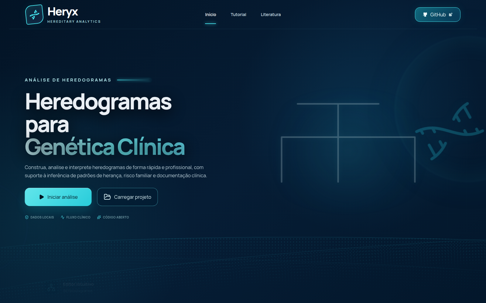

<div align="center">

# Heryx

### HEREDITARY ANALYTICS

**Heredogramas para genética clínica, documentação fenotípica e investigação familiar.**

[](https://jv130397.github.io/Heryx/?v=20261107.1)
[](https://github.com/jv130397/Heryx/actions/workflows/deploy-pages.yml)
[](https://react.dev/)
[](https://www.typescriptlang.org/)
[](#estado-do-projeto)

[**Abrir aplicação**](https://jv130397.github.io/Heryx/?v=20261107.1) · [**Ver documentação**](specifications/) · [**Consultar literatura**](literature/) · [**Reportar problema**](https://github.com/jv130397/Heryx/issues)

</div>



## O que é o Heryx?

O **Heryx — Hereditary Analytics** é uma aplicação web para construir, organizar e documentar heredogramas clínicos. O projeto reúne estrutura familiar, fenótipos, história clínica e observações individuais em um ambiente visual desenvolvido para pesquisa, ensino e apoio à investigação em genética clínica.

O editor reorganiza os membros da família conforme novos vínculos são adicionados, preservando gerações, núcleos familiares e legibilidade. Todo o fluxo foi pensado para acompanhar a investigação desde a criação do caso até a exportação do relatório.

> **Privacidade por padrão:** o projeto opera localmente no navegador. Arquivos clínicos só deixam o dispositivo quando o próprio usuário decide salvá-los ou exportá-los.

## Uma investigação completa em um único fluxo

| Construção familiar | Fenotipagem clínica | Documentação e saída |
|:---|:---|:---|
| Adição contextual de pais, parceiros, filhos e irmãos | Registro de termos da Human Phenotype Ontology | Salvamento de projeto editável |
| Organização automática por gerações | Histórico e observações por indivíduo | Exportação em PNG, SVG e PDF |
| Probando, afetados, óbitos e símbolos biológicos | Comparação de achados entre familiares | Relatório clínico estruturado |
| Reabertura de projetos já iniciados | Validação de consistência antes da exportação | Modo anonimizado para documentos |

## Principais recursos

- **Editor inteligente de heredogramas** com organização automática dos ramos familiares.
- **Criação orientada de vínculos**, diretamente a partir de cada indivíduo.
- **Registro clínico individual** com perfil, fenótipos, histórico e notas.
- **Busca e documentação HPO** para padronização dos achados fenotípicos.
- **Desfazer, refazer e zoom** durante a construção do projeto.
- **Validação clínica** de campos e relações antes da geração de documentos.
- **Persistência local** em arquivo JSON editável (`.rps.json`).
- **Exportação científica** do heredograma em PNG e SVG.
- **Relatório clínico em PDF**, com capa, resumo, heredograma, tabela HPO, história familiar, registros individuais, interpretação, limitações e referências.
- **Interface responsiva** para computadores, tablets e dispositivos móveis.

## Como utilizar

1. Acesse o [Heryx](https://jv130397.github.io/Heryx/?v=20261107.1).
2. Selecione **Iniciar análise** para criar uma família ou **Carregar projeto** para continuar um caso salvo.
3. Informe um código anonimizado e defina o probando.
4. Adicione os familiares a partir dos próprios símbolos do heredograma.
5. Registre fenótipos HPO, história clínica e observações.
6. Revise a consistência do projeto.
7. Salve o arquivo editável ou exporte o resultado em imagem ou PDF.

## Estrutura do relatório clínico

O relatório foi projetado como um documento A4 vertical, legível tanto na tela quanto na impressão:

1. Capa e identificação anonimizada do caso.
2. Síntese clínica e tabela de fenótipos HPO.
3. Heredograma completo e história familiar.
4. Registros dos indivíduos prioritários.
5. Linha do tempo, interpretação e pendências.
6. Métodos, limitações, literatura e assinaturas.

O conteúdo gerado pelo sistema é um recurso de documentação e apoio. Ele não constitui diagnóstico clínico.

## Fundamentos científicos

As regras de representação e documentação são orientadas por referências consolidadas em genética clínica:

- Bennett RL et al. *Recommendations for standardized human pedigree nomenclature.* Journal of Genetic Counseling, 1995.
- Bennett RL et al. *Standardized human pedigree nomenclature: update and assessment.* Journal of Genetic Counseling, 2008.
- Bennett RL et al. *Practice resource-focused revision: standardized pedigree nomenclature.* Journal of Genetic Counseling, 2022.
- Human Phenotype Ontology — terminologia padronizada para descrição fenotípica.

Consulte o [inventário de literatura](specifications/LITERATURE_INVENTORY.md) e o [registro de referências](specifications/REFERENCE_REGISTRY.md) para detalhes.

## Executar localmente

### Requisitos

- Node.js 22 ou superior
- pnpm

```bash
git clone https://github.com/jv130397/Heryx.git
cd Heryx/web
pnpm install --frozen-lockfile
pnpm check
pnpm dev
```

A aplicação estará disponível em `http://127.0.0.1:5175/` ou na porta indicada pelo Vite.

### Comandos úteis

```bash
pnpm dev        # ambiente de desenvolvimento
pnpm test       # testes automatizados
pnpm typecheck  # verificação TypeScript
pnpm build      # build de produção
pnpm check      # testes + build
```

## Arquitetura

```text
Heryx/
├── web/                # aplicação React + TypeScript
│   ├── public/         # recursos visuais públicos
│   └── src/            # editor, layout, validação e exportação
├── specifications/     # regras clínicas, arquitetura e modelo de dados
├── literature/         # referências científicas organizadas
├── examples/           # casos e exportações sintéticas
└── docs/               # documentação e recursos do repositório
```

## Documentação técnica e clínica

- [Regras do heredograma](specifications/PEDIGREE_RULES.md)
- [Catálogo de símbolos](specifications/SYMBOL_CATALOG.md)
- [Modelo de dados](specifications/DATA_MODEL.md)
- [Integração com HPO](specifications/HPO_DATA_MODEL_AND_INTEGRATION.md)
- [Arquitetura da aplicação](specifications/ARCHITECTURE.md)
- [Sistema visual](specifications/UI_DESIGN_SYSTEM.md)
- [Requisitos do projeto](specifications/REQUIREMENTS.md)
- [Implantação web](specifications/WEB_SITE_DEPLOYMENT.md)

## Tecnologias

`React 19` · `TypeScript` · `Vite` · `SVG` · `Framer Motion` · `Three.js` · `Vitest` · `GitHub Pages`

## Privacidade e uso responsável

- Prefira códigos anonimizados e evite identificadores pessoais desnecessários.
- Nenhum dado real de pacientes faz parte deste repositório.
- Revise todo documento antes de compartilhá-lo ou incluí-lo em prontuários.
- O Heryx não substitui avaliação clínica, aconselhamento genético ou interpretação por profissional qualificado.
- O software ainda não é um dispositivo médico validado.

## Estado do projeto

O Heryx está em **desenvolvimento ativo**. A versão atual é adequada para demonstração, pesquisa, ensino e avaliação do fluxo, mas ainda deve passar por validação clínica, testes de usabilidade e revisão de segurança antes de qualquer uso assistencial.

Contribuições, sugestões e relatos de problemas são bem-vindos nas [Issues](https://github.com/jv130397/Heryx/issues).

---

<div align="center">

### Heryx

**Genética · Família · Evidência**

[Acessar aplicação](https://jv130397.github.io/Heryx/?v=20261107.1) · [GitHub](https://github.com/jv130397/Heryx)

</div>
