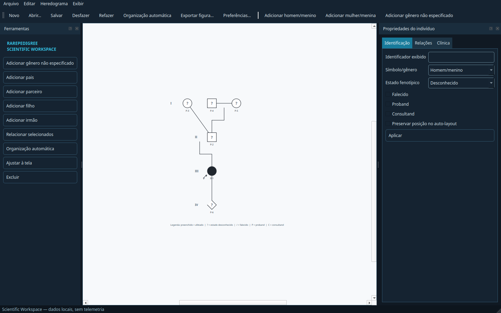

# RarePedigree Studio — Relatório da Fase 4.5

**Data:** 2026-10-30  
**Versão:** 0.2.0.dev0  
**Checkpoint anterior:** commit `296d0cd` (`checkpoint: phase 4 baseline`)

## Resultado

A Fase 4.5 evoluiu o protótipo existente sem substituir os módulos funcionais. O editor agora constrói e reorganiza famílias multigeracionais, mantém parentagem como dado explícito, oferece ações contextuais e apresenta a identidade visual **RarePedigree Scientific Workspace**.



## Referências de software

- [Open Pedigree](https://github.com/phenotips/open-pedigree): LGPL-2.1; consultado para comportamentos de famílias complexas, ações contextuais, consanguinidade, layout e exportação.
- [Documentação de handles PhenoTips](https://docs.phenotips.com/docs/handles): referência de fluxo para pais, irmãos, parceiros e descendentes.
- [Open Pedigree XML](https://fabianoposwar.com/heredograma/): demonstração funcional consultada, sem reutilização de código ou ativos.

Nenhum código, CSS, ícone ou design dessas ferramentas foi copiado. A implementação é própria em Python/PySide6. A revisão detalhada está em `REFERENCE_SOFTWARE_REVIEW.md`.

## Etapa A — preparação e compatibilidade

- Git inicializado localmente e baseline da Fase 4 preservado no commit `296d0cd`.
- Fixture real do schema 0.1.0 adicionada em `tests/fixtures/schema_0_1_0.rps.json`.
- Migração versionada 0.1.0 → 0.2.0 implementada.
- UUIDs de projeto, indivíduos e relacionamentos são preservados.
- Projetos com versão futura/desconhecida são rejeitados explicitamente.
- Aviso de alterações não salvas implementado para novo projeto, abertura e fechamento da janela.

## Etapa B — núcleo familiar

- `Family`, `Parentage`, `ParentageKind` e `TwinGroup` adicionados ao domínio.
- Parentagem diferenciada como biológica, gestacional, legal, social ou desconhecida.
- Ações contextuais reais: adicionar pais, pais desconhecidos, parceiro, filho, filho adotivo e irmão.
- Suporte a múltiplas uniões sem inferir parentagem pela posição do canvas.
- Pais desconhecidos são indivíduos placeholder explícitos, com contorno tracejado.
- Ciclos parentais e referências ausentes são rejeitados.
- Exclusão remove relações, parentagens e grupos dependentes de modo atômico e reversível.
- Grupos de gêmeos exigem os mesmos pais registrados.

## Etapa C — layout e conectores

- `PedigreeLayoutEngine` é Python puro e não importa Qt.
- Distribuição por gerações e espaçamento uniforme.
- Ordenação determinística, considerando posição dos pais e ordem anterior.
- Posições marcadas como bloqueadas sobrevivem ao auto-layout.
- Conectores parentais em cotovelo atualizam após movimentos.
- Gêmeos usam origem comum; monozigóticos recebem ligação adicional.
- Gerações são identificadas por algarismos romanos.
- Ajustes manuais continuam disponíveis após organização automática.

Limite: a minimização de cruzamentos é heurística; não é um otimizador global para grafos arbitrariamente complexos.
Guias magnéticas de alinhamento e preview de conectores antes da confirmação permanecem pendentes.

## Etapa D — RarePedigree Scientific Workspace

- Tema grafite/azul-marinho com detalhes ciano e canvas claro.
- Toolbar superior com arquivo, undo/redo, auto-layout, exportação e preferências.
- Toolbox esquerdo com ferramentas reais de construção e exclusão.
- Painel direito em abas: identificação, relações e espaço reservado para clínica/HPO/variantes.
- Menu contextual em cada pessoa.
- Seleção múltipla por área, zoom ancorado no cursor, pan com botão do meio e ajuste à tela.
- Preferências persistentes de escala PNG, margem e orientação PDF.
- Proband e consultand são diferenciados por `P`, `C` ou `P/C` junto à seta.

## Etapa E — símbolos

Implementados/testados nesta fase:

- parceria, consanguinidade, separação e divórcio;
- adoção por parentagem legal, com colchetes e linha tracejada;
- gêmeos monozigóticos e dizigóticos;
- placeholder de parentesco desconhecido;
- diferenciação visual entre proband e consultand.

Mantidos da Fase 4: quadrado, círculo, losango, afetado, não afetado, estado desconhecido e falecido.

Não implementados nesta fase:

- portadores por setores/padrões, pois ainda não há condição/variante e legenda associada;
- mosaicismo, que permanece dado estruturado sem glifo normativo único confirmado;
- gestação, SAB, TOP, ectópica e natimortalidade, que exigem um modelo de evento reprodutivo e QA visual dedicado.

Essas omissões evitam símbolos arbitrários ou clinicamente ambíguos.

## Etapa F — exportação científica

- SVG vetorial, PDF vetorial e PNG com escala configurável.
- Margem configurável e PDF A4 em retrato/paisagem.
- Ajuste do conteúdo à saída.
- Seleção azul é removida temporariamente durante a renderização e restaurada depois.
- Gerações romanas e legenda científica entram na figura.
- Exemplos gerados em `examples/exports/three_generation.{svg,png,pdf}`.

Limite: a legenda atual cobre estados básicos; padrões clínicos múltiplos ainda não existem.

## Etapa G — validação

Comandos finais:

```text
ruff check .
All checks passed!

QT_QPA_PLATFORM=offscreen pytest -q
.................... [100%]
20 passed
```

Cobertura funcional dos testes adicionados:

- migração 0.1.0 e preservação de UUIDs;
- relações parentais, ciclos e referências;
- inclusão contextual em três gerações;
- exclusão com limpeza de dependências e undo;
- auto-layout multigeracional e posição bloqueada;
- gêmeos com pais compartilhados;
- consanguinidade propagada do domínio até a cena gráfica;
- conectores e identificadores de geração;
- salvamento/reabertura multigeracional;
- SVG, PNG e PDF.

## Compatibilidade

- Arquivos `.rps.json` 0.1.0 continuam abrindo por migração em memória.
- Arquivos novos usam schema 0.2.0.
- Os UUIDs existentes não são recalculados; apenas o UUID de `Family` ausente é derivado deterministicamente do `project_id` legado.
- JSON continua sendo o único repositório; SQLite não foi introduzido.
- HPO, VCF e análise de segregação não foram implementados.

## Pendências

- Golden tests normalizados para todos os símbolos e revisão visual especializada NSGC.
- Preview interativo de uma relação antes da confirmação.
- Otimização de cruzamentos para pedigrees extensos e múltiplas uniões complexas.
- Modelo e símbolos de eventos reprodutivos.
- Editor de legendas por condição para portadores.
- Controles de relação gestacional/social/legal na UI além do fluxo de adoção.
- Configuração editorial avançada do PDF e identificação automática de indivíduos por geração.
- Testes de acessibilidade por leitor de tela e navegação integral por teclado.

## Critérios de conclusão

Os critérios centrais foram atendidos: construção contextual de família com três ou mais gerações, parentagem explícita, auto-layout, integridade após salvar/reabrir, migração de projeto antigo, identidade visual moderna, exportação científica e suíte automatizada verde. Os símbolos avançados ainda pendentes estão explicitamente registrados e não são declarados concluídos.
