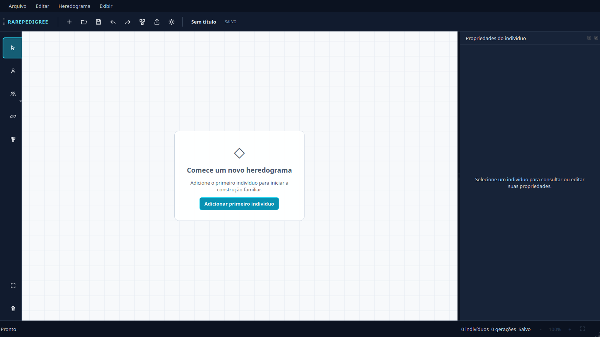
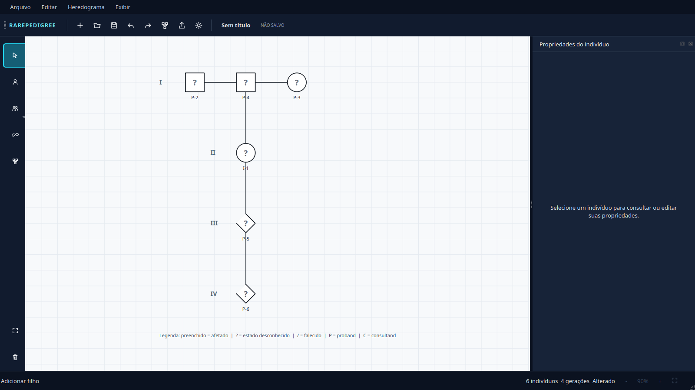
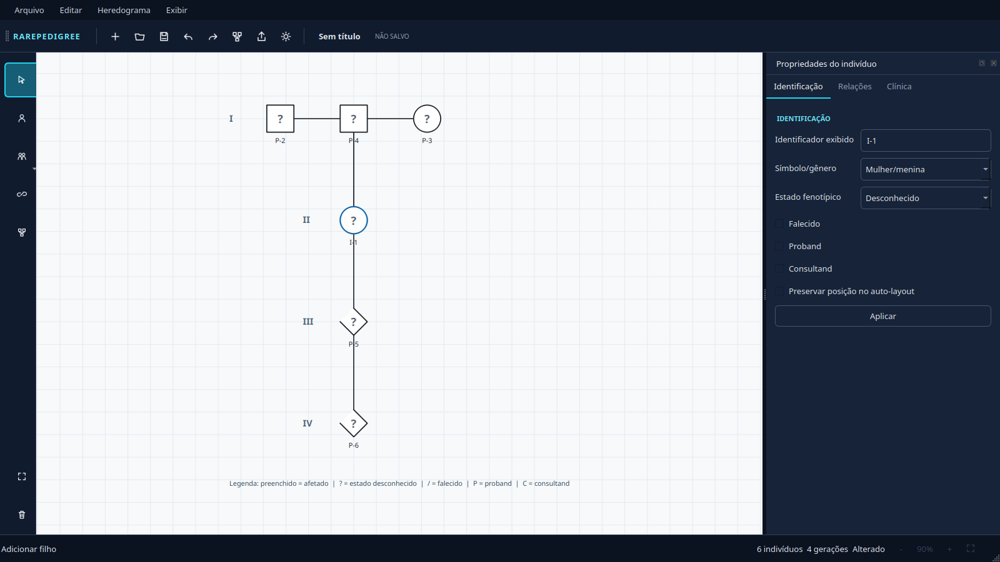
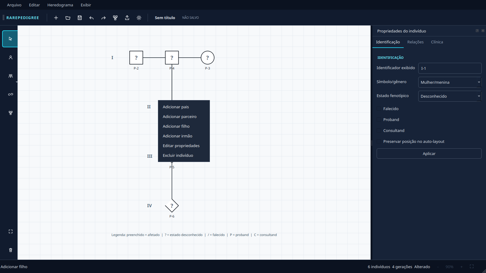
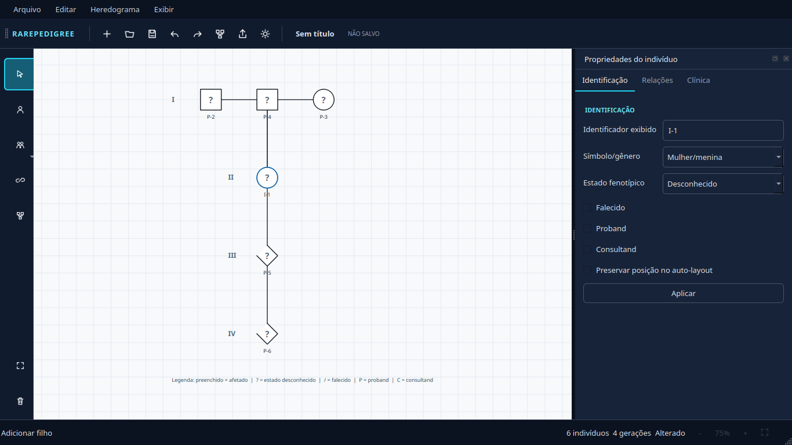
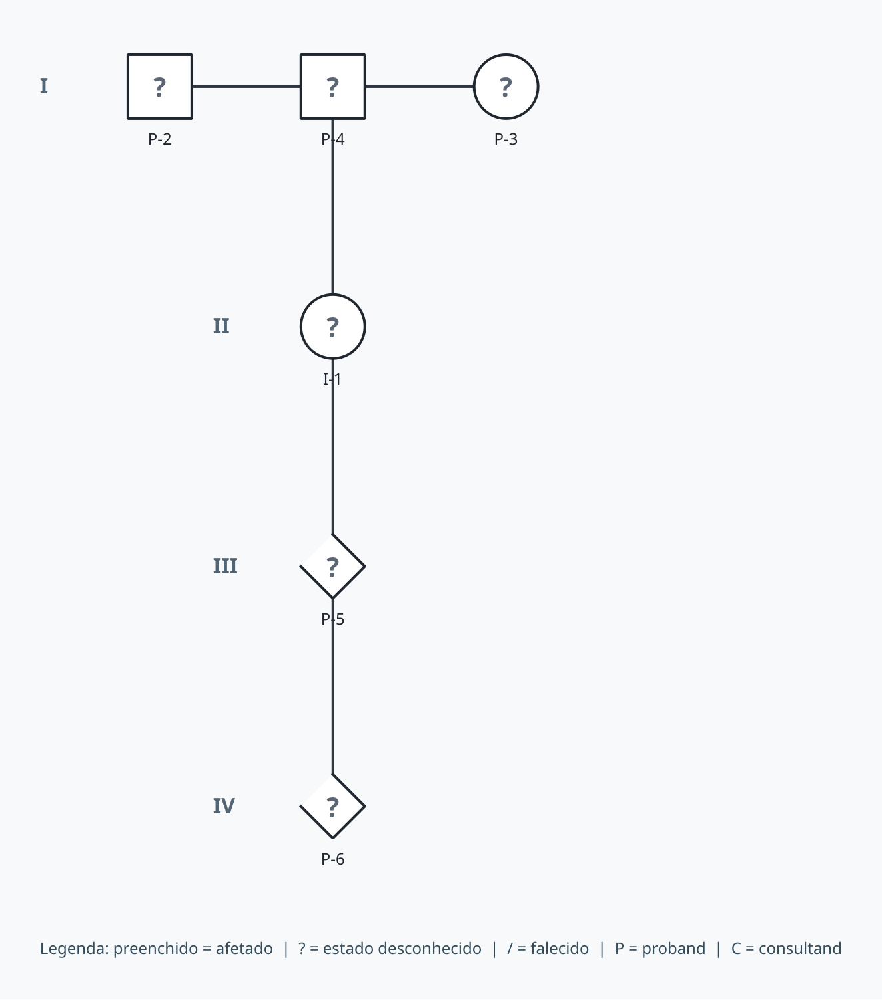

# RarePedigree Studio — Relatório da Fase 4.6

**Data:** 2026-10-30  
**Versão:** 0.2.0.dev0 / schema 0.2.0  
**Checkpoint de entrada:** tag `phase-4.5-checkpoint`, commit `cfbf4ae`

## Resultado

A apresentação foi redesenhada sem substituir arquitetura, domínio, layout, persistência ou
exportadores. A interface prioriza o canvas e apresenta comandos compactos, estado vazio
funcional, propriedades contextuais e status operacional.

## Arquivos e componentes

- `ui/theme.py`: tokens e QSS centralizados.
- `ui/icons.py`: conjunto SVG próprio.
- `ui/components.py`: rail, menu familiar, estado vazio, cabeçalhos e zoom.
- `ui/properties.py`: formulário contextual e relações calculadas.
- `ui/main_window.py`: cinco áreas e integração das ações existentes.
- `rendering/view.py`: grade não exportável, zoom informado e navegação.
- `tools/capture_phase_4_6.py`: evidência visual reprodutível.
- `tests/unit/test_workspace_ui.py`: validação da experiência.

Veja [UI_DESIGN_SYSTEM.md](UI_DESIGN_SYSTEM.md).

## Funcionalidades preservadas

- Schema 0.2.0, UUIDs e migração 0.1.0.
- Inclusão contextual, múltiplas uniões e parentagem explícita.
- Consanguinidade, adoção e gêmeos.
- Undo/redo, auto-layout e posições bloqueadas.
- Persistência JSON e exportação SVG/PNG/PDF.
- Geometria e significado científico dos símbolos.

## Problemas corrigidos

- Toolbar textual/duplicada substituída por grupos compactos com SVG e tooltips.
- Toolbox larga substituída por rail de 58 px com menu familiar expansível.
- Formulário vazio substituído por orientação explícita quando não há seleção.
- Relações de pais, parceiros e filhos aparecem coerentemente no painel.
- Projeto vazio oferece ação funcional para o primeiro indivíduo.
- Status informa contagem, gerações, salvamento e zoom.
- Grade e decoração ficaram fora da cena exportável.
- Scrollbars do canvas foram removidas; pan e ajuste continuam disponíveis.
- Exclusão pela ferramenta recebe confirmação e operações continuam reversíveis.

## Validação visual real

### Janela inicial



### Família sintética multigeracional



### Seleção e propriedades



### Menu contextual



### Resolução reduzida 1366×768



### Exportação sem decoração



As capturas vêm de widgets e cena reais. A inspeção corrigiu estado vazio expandido,
scrollbars excessivas e ausência inicial da orientação sobre o canvas. Não foram observados
textos cortados, controles sobrepostos ou perda do canvas em 1366×768.

## Testes

```text
ruff check .
All checks passed!

QT_QPA_PLATFORM=offscreen pytest -q
.............................. [100%]
30 passed
```

Além dos 20 testes anteriores, a fase cobre inicialização, toolbar, estado vazio, seleção,
relações, zoom, preferências, quatro resoluções e exportação sem elementos decorativos.

## Limitações

- Guias magnéticas não foram introduzidas; o auto-layout foi preservado.
- Mover permanece por arraste direto, sem máquina de ferramentas separada.
- Leitor de tela requer auditoria manual na plataforma de destino.
- O menu familiar depende de seleção válida e informa ausência por diálogo.
- A minimização de cruzamentos continua heurística.

## Recomendações para a Fase 5

- Manter clínica/genética como módulos desacoplados consumidos pelo painel reservado.
- Definir modelos e vocabulários HPO/HGVS antes de adicionar campos visuais.
- Criar componentes de condição/variante sobre o design system existente.
- Preservar dados científicos na cena/domínio e decoração somente em widgets.
- Adicionar testes de acessibilidade assistida e golden images por plataforma.

HPO, HGVS, VCF e análise de segregação não foram implementados nesta fase.
