# RarePedigree Studio — Relatório da Fase 4.7

**Data:** 2026-10-30  
**Versão:** 0.2.0.dev0 / schema preservado em 0.2.0  
**Checkpoint:** tag `phase-4.6-checkpoint`, commit `1737046`

## Resultado

A interface evoluiu para **Midnight Genomics**, tomando a imagem fornecida como referência de
hierarquia, densidade e proporções. Não foram copiados logotipo, DNA decorativo ou ativos. O
domínio, UUIDs, relações, layout, JSON e exportadores existentes foram preservados.

## Implementação

- Primeira inicialização bilíngue com preferência persistida.
- Catálogo central PT-BR/EN por `QTranslator` e troca sem reinício.
- Toolbar agrupada com idioma, salvamento e projeto.
- Painel esquerdo com ícones, rótulos e menus de indivíduo/família.
- Zoom flutuante, canvas branco-azulado e grade não exportável.
- Cores configuráveis de contorno para categorias de representação.
- Fenótipo preservado por preenchimento e convenções normativas.
- Modo científico monocromático na tela e independente na exportação.
- Editor flutuante com cartões de símbolo, prévia, validação, cancelar e operação única.
- Duplo clique, menu contextual, painel e `Ctrl+I` abrem edição.
- Assistente de novo projeto com metadados e indicação explícita de exemplo sintético.
- Preferências em Aparência, Idioma, Heredograma e Exportação.
- Legenda configurável e adaptada ao modo visual ativo.
- Notificações temporárias sem dados clínicos.

## Arquivos principais

- `ui/i18n.py`, `ui/startup.py`: idioma e onboarding.
- `ui/dialogs.py`: editor e assistente de projeto.
- `ui/preferences.py`: preferências em abas e seleção de cores.
- `rendering/style.py`: configuração visual separada do domínio.
- `rendering/items.py`, `scene.py`, `exporters.py`: cor segura, legenda e exportação.
- `ui/main_window.py`, `components.py`, `theme.py`: composição Midnight Genomics.
- `tests/unit/test_phase_4_7.py`: cobertura específica.
- `tools/capture_phase_4_7.py`: evidência visual reprodutível.

## Validação visual

1. 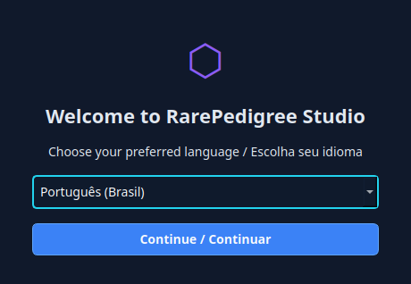
2. 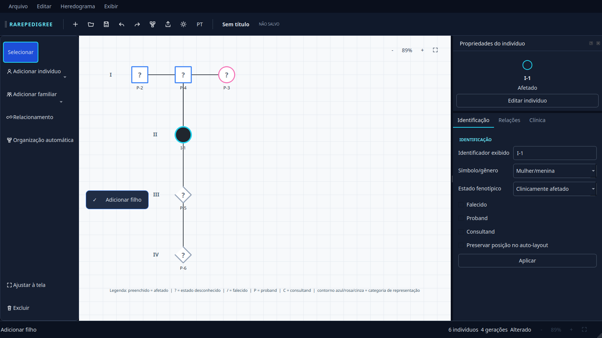
3. 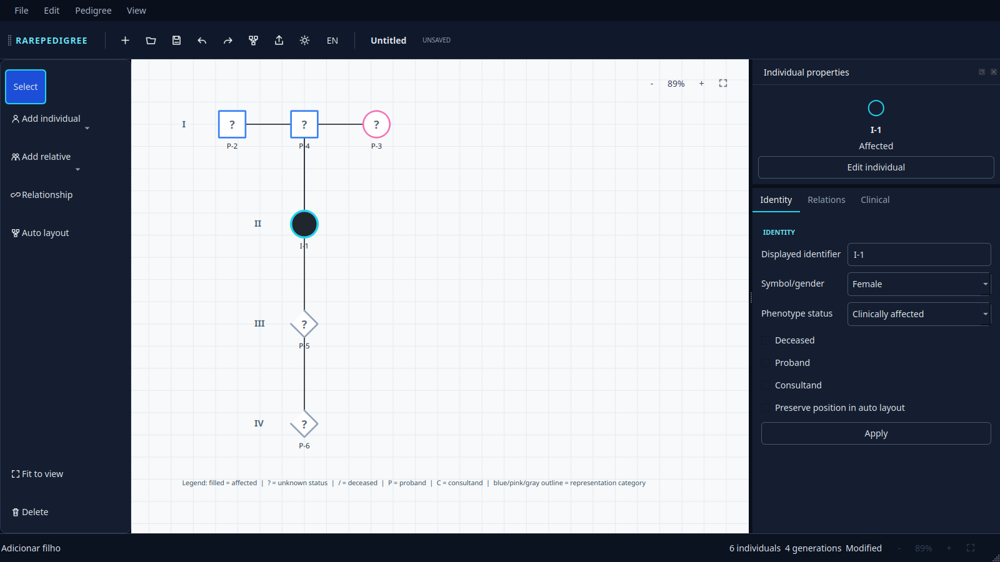
4. 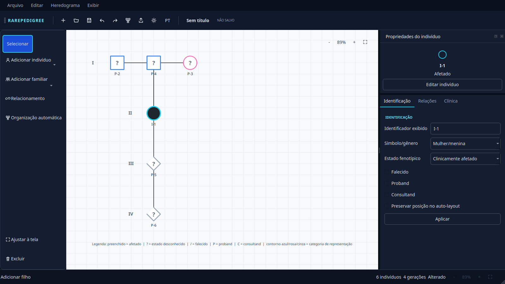
5. 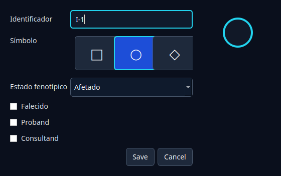
6. 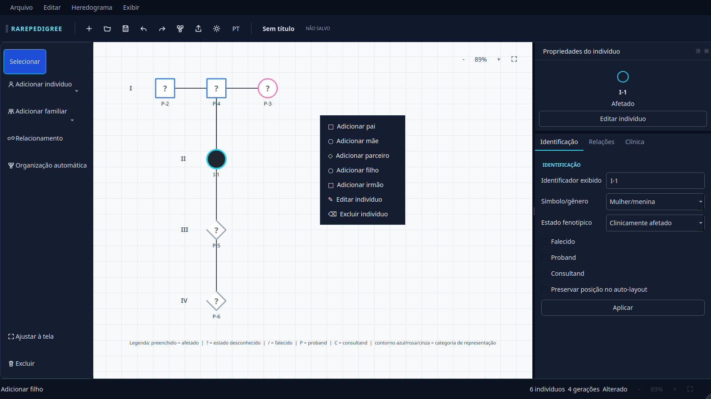
7. 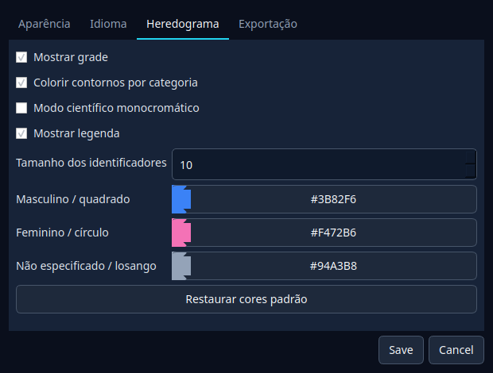
8. 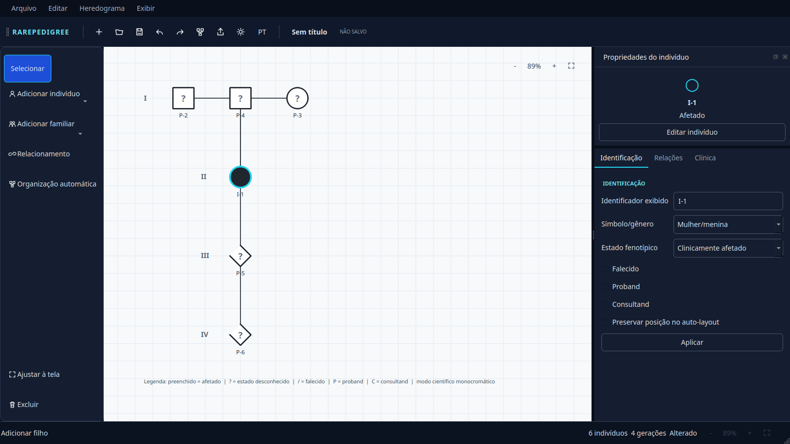
9. 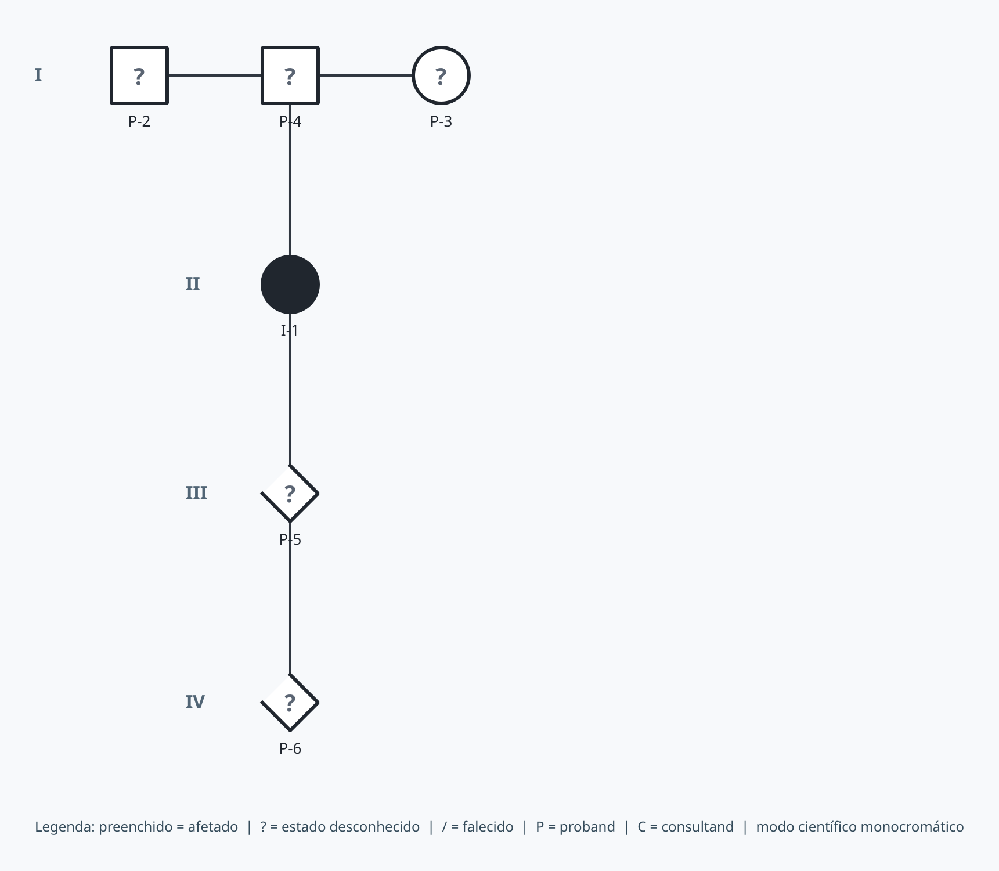
10. 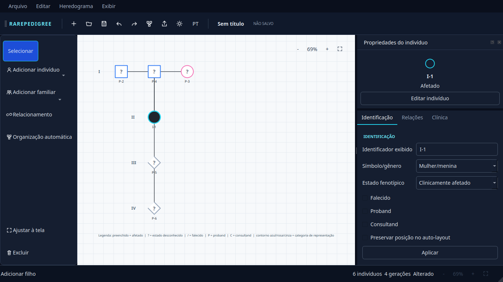
11. 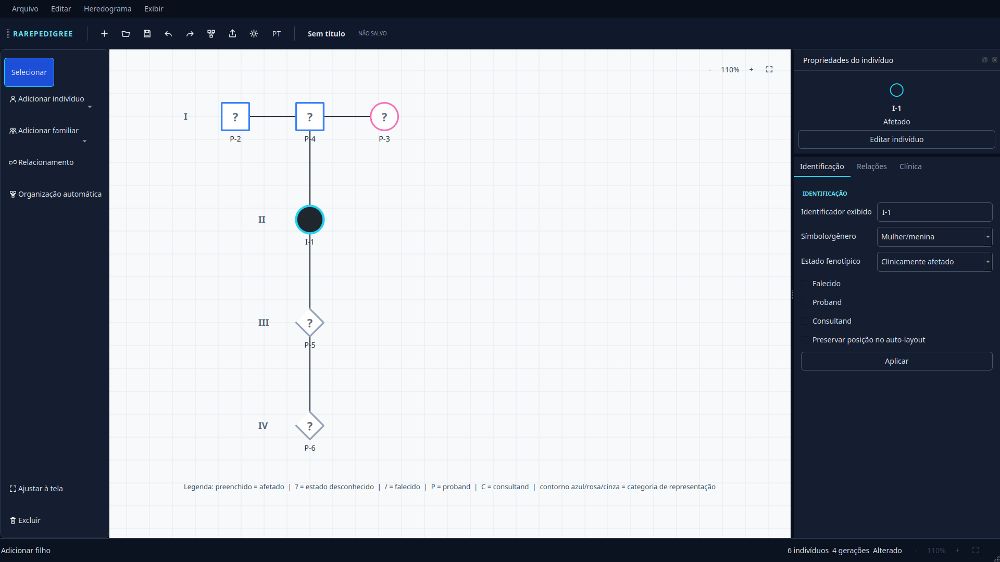

A inspeção real corrigiu onboarding sem tema, rótulos truncados, seleção perdida após mudança
de modo e tradução incompleta das superfícies principais. Em 1366×768 o canvas permanece
dominante e os campos do painel continuam acessíveis.

## Testes

```text
ruff check .
All checks passed!

QT_QPA_PLATFORM=offscreen pytest -q
...................................... [100%]
38 passed
```

Os oito testes novos cobrem primeira inicialização, persistência e troca de idioma, separação
entre cor/fenótipo, exportação monocromática, cancelamento e valores do editor, assistente de
projeto e preferências de cores/legenda. A fixture JSON 0.1.0 e todos os testes anteriores
continuam passando.

## Limitações remanescentes

- O catálogo cobre toda a superfície operacional principal; mensagens técnicas originadas no
  domínio continuam em inglês e devem receber códigos de erro estáveis numa fase posterior.
- O exemplo sintético é pequeno e genérico; não pretende demonstrar todas as relações avançadas.
- Sexo atribuído ao nascimento ainda não é um campo distinto no domínio; a UI não o deduz da
  identidade de gênero e trata as cores somente como categorias de representação gráfica.
- Guias magnéticas e preview de novos conectores permanecem pendentes.
- Auditoria manual com leitor de tela ainda é necessária na distribuição final Ubuntu.

## Recomendações para a Fase 5

- Introduzir códigos de erro traduzíveis antes de ampliar validações clínicas.
- Modelar sexo atribuído ao nascimento separadamente, mediante revisão científica.
- Manter HPO/HGVS/VCF fora de preferências globais e em módulos clínicos próprios.
- Preservar o modo monocromático como padrão editorial para publicação.
- Adicionar testes golden por plataforma e auditoria assistiva.

HPO, HGVS, VCF e análise de segregação não foram implementados.
